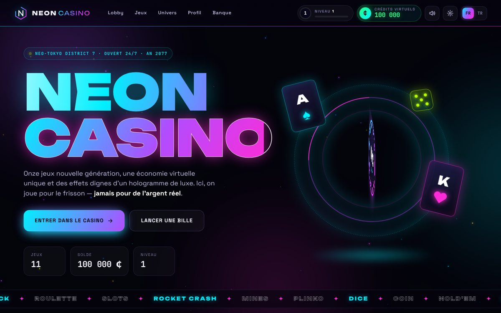
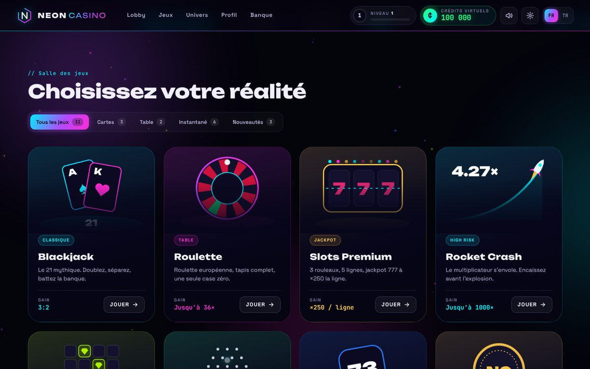
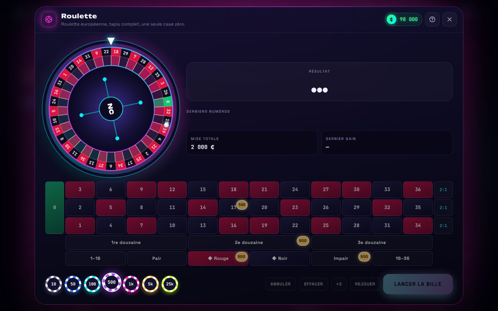
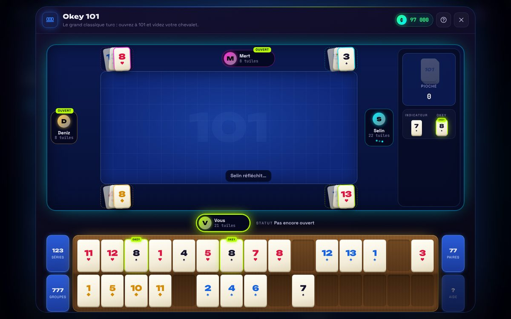
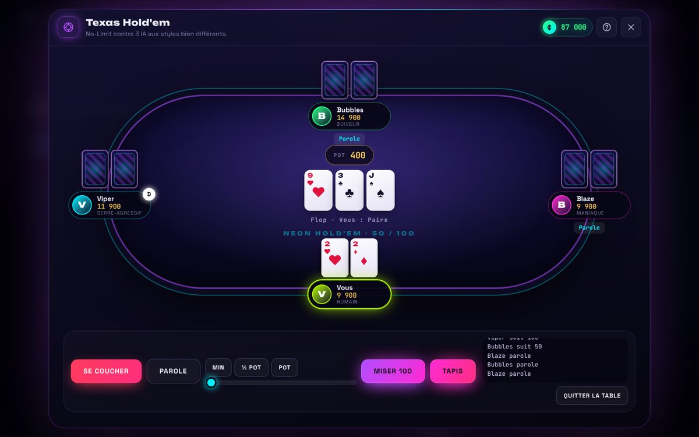
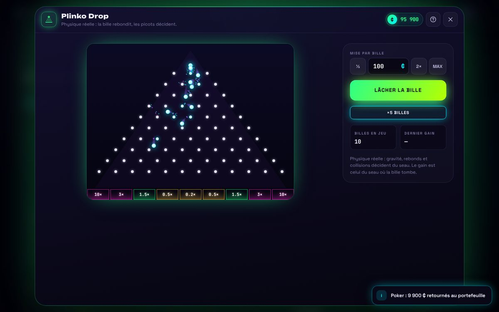
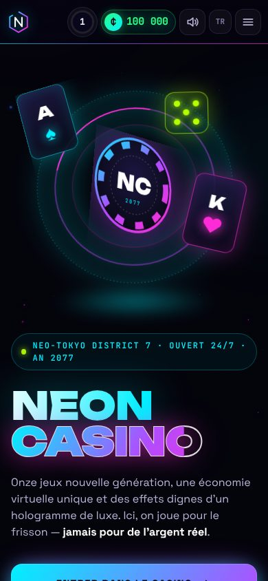

# NEON CASINO — Next Gen

A futuristic, cyberpunk-styled **virtual casino** that runs entirely in your browser. Eleven games, one shared wallet, levels, loans, synthesized sound and a lot of neon. French and Turkish interface.

> **Virtual credits only.** The "₵" credits have no value and cannot be bought, sold or exchanged. There is no deposit, withdrawal or payment code anywhere in this project. It is made for entertainment and learning.

**Play online:** `https://YOUR-PROJECT.vercel.app` *(replace this with your own link after you deploy; see the guide below)*



---

## Contents

- [Games](#games)
- [Screenshots](#screenshots)
- [Run it on your computer](#run-it-on-your-computer)
- [Put it online with GitHub and Vercel (step by step)](#put-it-online-with-github-and-vercel-step-by-step)
- [How the virtual economy works](#how-the-virtual-economy-works)
- [Plinko: the protected physics](#plinko-the-protected-physics)
- [Sound, effects and accessibility](#sound-effects-and-accessibility)
- [Project layout](#project-layout)
- [Tests](#tests)

---

## Games

| # | Game | Highlights |
|---|------|-----------|
| 1 | **Blackjack** | 6-deck shoe, dealer stands on all 17s, dealer peeks for blackjack, 3:2 blackjack, Double, Split, keyboard shortcuts |
| 2 | **Roulette** | European single zero, full betting board, several chips, undo / ×2 / rebet. The wheel turns, the ball is launched, slows down, drops and bounces between pockets, and always stops in the pocket of the number drawn |
| 3 | **Slots Premium** | 3×3 grid, 5 paylines, real reel strips (what you see is what is paid), reels that really spin, exact return 95.8 %, jackpot 777 |
| 4 | **Rocket Crash** | Proper crash curve (chance to reach m× is 99 % ÷ m), auto cash-out, safe against late clicks |
| 5 | **Neon Mines** | 1–24 mines, fair multiplier × 0.98, live odds, full reveal after a loss |
| 6 | **Plinko Drop** | Original physics preserved (see below), glowing pegs, trails, up to 15 balls at once |
| 7 | **Dice Roll** | Over/Under, chance and multiplier shown (98 ÷ chance) |
| 8 | **Virtual Coin** | Real 3D coin with thickness (NC face and Alien face), tossed, flipped, bounced, always lands on the drawn face |
| 9 | **Texas Hold'em** | No-Limit against 3 AI players with different styles, blinds, side pots, split pots, natural pacing |
| 10 | **Okey 101** | Classic Okey table, two-row wooden rack with drag-and-drop, 106 tiles, jokers, 101-point or 5-pair opening, 3 AI opponents, real scoring |
| 11 | **Baccarat** | Punto Banco, 8-deck shoe, full third-card rules, pair bets, results history |

Every game has a **?** button with its full rules and payouts.

## Screenshots

| Lobby | Roulette |
|---|---|
|  |  |

| Okey 101 | Texas Hold'em |
|---|---|
|  |  |

| Plinko Drop | Mobile |
|---|---|
|  |  |

---

## Run it on your computer

You do **not** need to install anything to try it.

**Easiest way:** open the file `index.html` in Chrome, Edge, Firefox or Safari (double-click it).

**Recommended way** (a tiny local web server, if you have Python installed):

```bash
python3 -m http.server 8765
```

Then open <http://localhost:8765> in your browser.

The page loads its fonts from Google Fonts. Offline, it falls back to system fonts and everything still works.

**Language:** use the **FR / TR** switch in the top bar. Your choice is saved. By default the site follows your browser language (Turkish if your browser is Turkish, otherwise French).

---


## How the virtual economy works

- Starting balance: **100,000 ₵**. Progress from the first version of this project (`neon_casino_ultra` save) is migrated automatically.
- One wallet for all 11 games (`js/core/store.js`). Every round goes through `NC.startRound()` and `round.settle()`:
  - a bet is only taken if it is valid (whole number, at least 1, not more than the balance),
  - a round can be settled **only once** (no duplicate payouts),
  - the balance can never go below zero.
- **Loans:** 1,000 ₵ each, up to 3. Partial or full repayment. When the balance reaches twice the debt, the debt is collected automatically.
- **XP and levels:** XP comes from playing and winning. Level N needs N × 500 XP. Each level gives a bonus of level × 250 ₵.
- Saved in `localStorage`. Poker chips sitting on the table are saved too and returned to the wallet if the page is closed mid-session.
- Closing a game in the middle of a round is always fair: Crash and Mines cash out, Blackjack plays out your hand, Plinko finishes each ball's real trajectory, and so on.

## Plinko: the protected physics

The ball physics are kept **line for line** from the original project (`js/games/plinko.js`): gravity 0.25, friction 0.99, restitution 0.5, wall bounce −0.8, peg collisions with exact surface correction and reflection `v' = v − 2(v·n)n`, the same random kick on each hit, the same centred drop, the same peg layout and multipliers. The payout is the bucket the ball physically falls into.

A test (`tests/logic.test.js`) contains a verbatim copy of the original loop and checks that, for 2,000 seeded drops, the new code produces **exactly the same trajectory, coordinate for coordinate**.

Only two bugs were fixed, without touching any formula:

1. **Screen size changed the odds.** The original simulated in screen pixels, so on a phone the pegs were closer together than on desktop (measured return: 93 % on desktop, 231 % on a phone). The simulation now always runs on the original 600 × 450 board and is only scaled when drawn.
2. **Refresh rate changed the speed.** Balls fell twice as fast on 120/144 Hz screens. Physics now runs at exactly 60 steps per second.

## Sound, effects and accessibility

- Sounds are generated live with the Web Audio API (no audio files). Nothing plays before your first click. Use the speaker button to turn sound on or off.
- The sparkle button reduces optional effects (particles, confetti, animated backgrounds).
- Game animations (roulette, reels, coin, dealt cards) are the game itself and always play. When the operating system's "reduce motion" setting is on, only decorative background animations are calmed.
- Keyboard: `Esc` closes a game. In Blackjack, `H` / `S` / `D` / `P` and `Enter` play. In Slots and Crash, `Space` spins or launches.

---
